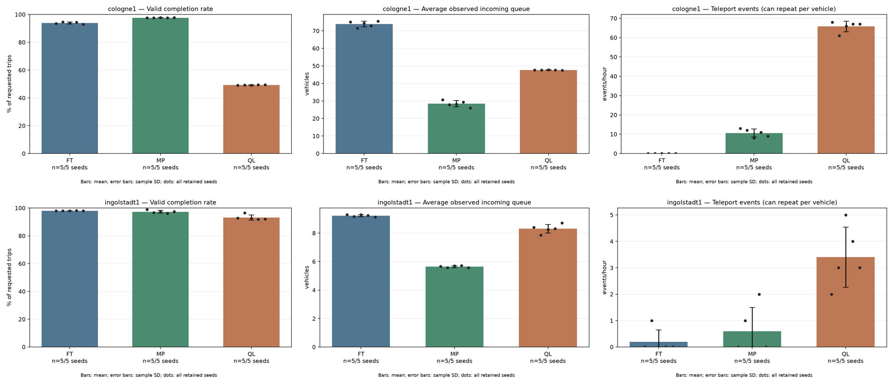

# Giai đoạn 6 — đánh giá FT, MP và Q-Learning — 15/11/2026

Đã chạy **30/30 lượt chính**, mỗi lượt 3600 giây, đủ năm seed cho mỗi thuật
toán trên từng map. Giữ nguyên tất cả lượt, kể cả collision, teleport, đói
movement và tỷ lệ hoàn thành thấp. Không train thêm, đổi policy/state/reward,
hyperparameter, sửa data, commit hoặc push.

**Kết quả đáng chú ý:** Cologne1 QL có waiting/travel thấp trên nhóm hoàn thành,
nhưng chỉ hoàn thành hợp lệ khoảng 49% nhu cầu, bỏ xanh 10/20 movement cả giờ.
MP Cologne1 có throughput/completion cao hơn và queue thấp hơn FT trong tập
này, nhưng vẫn có teleport. Ingolstadt1 không cho cùng thứ tự trên mọi metric:
MP có queue thấp nhất, FT có completion trung bình cao hơn; QL chưa vượt hai
baseline khi xét đồng thời service và thời gian chuyến.

**Giới hạn tái hiện phải công bố:** công thức và bảng/biểu đồ có thể tái tạo
chính xác từ raw XML/CSV, nhưng chưa bảo đảm chạy lại SUMO cùng seed sẽ khớp
từng dòng. Kiểm tra lặp không bật tripinfo cũng đã có sai khác. Do đó chưa
chứng minh được yêu cầu output hoàn toàn không tác động quỹ đạo ở mọi lượt;
không quy sai khác cho tripinfo hoặc một lỗi SUMO cụ thể khi chưa đủ bằng chứng.
Các kết quả bên dưới là mô tả những lượt thực sự đã lưu, không phải kết luận
thống kê có ý nghĩa hoặc chứng nhận an toàn.

## 1. Thiết kế và cấu hình chung

Git ban đầu sạch tại `aa64b2f7e3f9cbedf4655f1c1eff5d91f11b6370`.
Phiên bản bàn giao là working tree chưa commit trên HEAD này; SHA từng script,
binary SUMO, Python/package và diff nằm trong [provenance.json](provenance.json).
Không dùng HEAD một mình để giả định rằng code mới đã nằm trong commit đó.

Đã đọc AGENTS.md, môi trường, ba thuật toán, toàn bộ test cũ, báo cáo stage3–5,
summary/analysis stage5, tải và kiểm tra metadata/rows của hai model cuối.
Baseline là **99 passed**. Kế hoạch và phạm vi ở [PLAN.md](PLAN.md).

| Cấu hình | Cologne1 | Ingolstadt1 |
|---|---|---|
| Net/route/config | `data/cologne1/cologne1.*` | `data/ingolstadt1/ingolstadt1.*` |
| Khoảng giờ gốc | [25200,28800) | [57600,61200) |
| Nhu cầu yêu cầu trong khoảng giờ | 2015 trip | 1716 trip |
| Action ID gốc | 0,1,2,3,4,5,6,7 | 0,2,4 |
| TLS | cluster_357187_359543 | cluster_274083968_cluster_1200364014_1200364088 |
| Movement / incoming lane duy nhất | 20 / 8 | 8 / 7 |
| Xanh mỗi lượt quyết định | 30 s | 30 s |
| Vàng khi đổi action | 8 s | 6 s |
| Đỏ | ít nhất 2 s, chờ clear cả đuôi xe | ít nhất 2 s, chờ clear cả đuôi xe |

SUMO/TraCI/sumolib **1.28.0**, step-length **1 s**, headless Windows.
`collision.check-junctions=true`, `collision.action=teleport`, giữ ngưỡng
`time-to-teleport` mặc định 300 s của bản cài này. Cùng runtime chỉ G/r;
không mở g/s, không xem vàng/đỏ là action. Cùng action giữ xanh thêm 30 s,
không thêm chuyển tiếp. Horizon được quyền cắt lượt cuối ở vàng/đỏ/xanh.
Không kết thúc sớm khi tạm hết xe.

Thứ tự chạy cố định: map → seed → FT, MP, QL. Seed chính:
**42, 12345, 2026, 2027, 2028**; mỗi seed dùng cho cả ba thuật toán.
Seed train 23423 không nằm trong bảng chính. Hai seed 42/12345 đã được xem
trong stage5 nên đây là held-out so với **training**, không phải tập test
chưa từng được quan sát; stage6 không dùng chúng để điều chỉnh model.

`evaluate.run_evaluation()` dùng chung cấu hình và recorder. FT gọi
`ft.fixed_time()`, MP gọi `mp.max_pressure()`; QL gọi `load_q_table()`,
`encode_state()` và `choose_action(epsilon=0)` qua `greedy_steps()`.
Mọi thuật toán thực thi bằng `SumoEnv.step()`. Không dùng reward để xếp hạng.
`verify_common_configuration()` từ chối trộn input/config/code hoặc model QL
khác giữa seed; `experiment_coverage()` liệt kê seed thiếu và từ chối trùng lượt.
[verification.json](verification.json) ghi 30/30 và cấu hình thực đã đối chiếu.

## 2. Model QL cố định và phiên bản dữ liệu

| Map | Model cuối stage5 | State đã học | SHA-256 trước = sau |
|---|---|---:|---|
| Cologne1 | `../stage5/train/cologne1/cologne1_q_table.json` | 57 | `6b824ae7dbe63e93cef9f03bd1fa757d727c3b3153321121f7bdd8ad3bd9b4d9` |
| Ingolstadt1 | `../stage5/train/ingolstadt1/ingolstadt1_q_table.json` | 15 | `564a6fae2b8e22044fbaabd8b46ea38631f1f7fa170687eb992843cee1a73daa` |

Hai model đúng bản cuối episode 3 của stage5. Evaluation không có exploration
RNG, không cập nhật Q, không chèn state lạ, không lưu model mới. State lạ đọc
Q=0; hòa chọn action đầu theo code cũ. Kiểm tra cả bản sao Q-table trong RAM
và SHA file trước/sau từng lượt, rồi kiểm tra lại model sau toàn thí nghiệm.

[source_hashes_before.json](source_hashes_before.json),
[source_hashes_main_start.json](source_hashes_main_start.json) và
[source_hashes_after.json](source_hashes_after.json) chứng minh data/model không
đổi. FT/MP/QL không đổi so với Git HEAD. Snapshot main_start là code dùng cho
30 lượt; snapshot sau có thêm các test đọc raw sau chạy. Metadata mỗi lượt lưu
SHA code/input thực tại lúc khởi chạy, phiên bản SUMO, seed và action mapping.

QL **mới train 3 episode**, không có bằng chứng hội tụ. 57/52488 và 15/2187
state lý thuyết đã xuất hiện trong bảng; state 0 / 1–4 / ≥5 làm đồng nhất
queue 5 xe và queue rất lớn. Triển khai đúng công thức không có nghĩa policy
đã học tốt. Giai đoạn này giữ nguyên mọi giới hạn đó.

## 3. Công thức, đơn vị và mẫu số

Gọi D là số trip yêu cầu có depart dự kiến trong [begin,end), I là số đã chèn,
A là tổng đến đích SUMO ghi, T là tập ID từng bắt đầu teleport ít nhất một lần,
V là tập chuyến đến đích không vaporized và không thuộc T, N=|V|. Departure
trong công thức travel là **actual departure**, không phải thời điểm yêu cầu.
Arrival có timestamp đúng end được giữ vì phát sinh trong bước mô phỏng cuối.

| Metric chính | Công thức | Đơn vị / code |
|---|---|---|
| Average Waiting Time | Σ waitingTime(v) / N, v thuộc V | s/xe; `trip_metrics()` |
| Average Travel Time | Σ(arrival(v)−depart(v)) / N | s/chuyến; `trip_metrics()` |
| Average Queue Length | Σ từ k=1..3600 q(k) / 3600 | xe; `signal_metrics()` |
| Average Time Loss | Σ timeLoss(v) / N | s/xe; `trip_metrics()` |
| Throughput chính | N × 3600 / horizon | chuyến hợp lệ/giờ |
| Throughput mọi arrival | A × 3600 / horizon | chuyến đến đích/giờ, có thể từng teleport |
| Completion Rate | N / D | tỷ lệ 0–1, biểu đồ/báo cáo đổi sang % |
| Insertion Rate | I / D | tỷ lệ 0–1 |
| Tỷ lệ chưa chèn | (D−I) / D | tỷ lệ 0–1 |

Ba trung bình waiting/travel/timeLoss dùng **cùng nhóm V và mẫu số N**.
`completed_metric_count` ghi rõ N từng lượt. Không dùng trung bình theo xe
hoàn thành như đại diện cho tất cả nhu cầu; nhóm V giữa thuật toán có thể khác
nhau. Nếu N=0, ba trung bình là null/ô trống, không đặt bằng 0.

WaitingTime là thời gian SUMO ghi xe chờ vì giao thông với tốc độ ≤0.1 m/s,
loại scheduled stops; không cộng `departDelay`. TimeLoss lấy đúng trường
SUMO, gồm mất thời gian do chạy dưới tốc độ lý tưởng, không suy từ reward.
Travel được kiểm tra độc lập bằng `duration == arrival−depart` ở mọi chuyến V.
Tham khảo [SUMO TripInfo](https://sumo.dlr.de/docs/Simulation/Output/TripInfo.html).

Queue lấy từ `SumoEnv._run_signal()`: `getLastStepHaltingNumber()` trên
`incoming_lanes` duy nhất, lấy cuối mỗi bước 1 giây và bao gồm vàng/đỏ.
Không cộng lại lane theo controlled links. Đây chỉ là queue tại vùng đo;
không gồm xe chưa chèn, internal hoặc ùn kéo dài trên edge phía trước.
Do đó queue giảm không tự chứng minh lưu thông tốt hơn.

Mean trong bảng là trung bình **năm giá trị metric theo lượt**, không gộp
xe hai map hoặc trộn nhóm xe mọi seed. SD mẫu: sqrt(Σ(x−mean)²/(n−1));
n<2 thì để trống. CSV lưu cả n metric hợp lệ, n seed, min/max.

## 4. Xe chưa xong, chưa chèn và teleport

Chỉ thêm keyword `tripinfo=False` vào môi trường; khi bật và có output_dir,
`reset()` thêm ba tùy chọn output: `--tripinfo-output`,
`--tripinfo-output.write-unfinished true`, `--tripinfo-output.write-undeparted true`.
Không sửa tín hiệu, timing, clearance, reward hoặc thuật toán.
Đã kiểm tra hỗ trợ bằng `sumo --help` và XML thực 1.28.0.

- Depart <0: **undeparted**, loại khỏi tất cả trung bình chuyến và arrival.
- Depart ≥0, chưa arrival hợp lệ: **unfinished**, không gán travel=0; duration
  trong XML của chúng chỉ là thời gian đã chạy đến lúc đóng mô phỏng.
- Mỗi `getStartingTeleportIDList()` được ghi theo giây. `teleports` đếm sự
  kiện; `teleported` đếm tập ID duy nhất; teleport end không tạo lượt mới.
- Arrived từng teleport được ghi `arrived_teleported`, loại khỏi N và
  throughput chính; vẫn giữ trong A/throughput_all_arrivals. Xe từng teleport
  nhưng chưa tới đích được ghi `unfinished_teleported`.
- `loaded`/`inserted`/`running`/`waiting` của statistics được giữ nguyên; không
  dùng `loaded` thay D một cách mặc định, không suy arrived chỉ từ hiệu hai số.
  `requested_trips()` đọc route và từ chối flow/depart không hỗ trợ.

Ở **cả 30 lượt**, kiểm tra độc lập cho thấy:
`D=loaded=undeparted+unfinished+arrived`, `I=unfinished+arrived`,
`arrived=N+arrived_teleported`, `teleported=arrived_teleported+unfinished_teleported`.
Không có nhóm xe mất dấu trong các lượt này.
[independent_checks.json](independent_checks.json) giữ đối chiếu từng lượt.

Ví dụ pilot Cologne1 QL seed42: D=2015; I=1166; A=1053 gồm 995 hợp lệ và
58 từng teleport; unfinished=113 gồm 1 từng teleport; undeparted=849.
**67 sự kiện trên 59 xe**, không phải 67 xe khác nhau. Waiting=13.759799 s/xe
trên 995 chuyến, không phải trên 2015 yêu cầu. SUMO vehicleTripStatistics khi
bật unfinished có count=1166 và waitingTime=289.81: mẫu khác nên không dùng
thay cho 13.759799. Xem [SUMO statistic output](https://sumo.dlr.de/docs/Simulation/Output/StatisticOutput.html).

## 5. Kết quả từng lượt — không bỏ seed

W=waiting, TT=travel, Q=queue, TL=timeLoss. W/TT/TL đơn vị giây; Q đơn vị xe;
throughput là số chuyến hợp lệ/giờ. Completion/Insertion ở bảng là phần trăm.
Tất cả số dưới được làm tròn để đọc; [runs.csv](runs.csv) giữ giá trị đầy đủ.

### cologne1 — chất lượng và tỷ lệ phục vụ

| Algorithm | Seed | W s | TT s | Q xe | TL s | Throughput | Completion % | Insertion % |
|---|---|---|---|---|---|---|---|---|
| FT | 42 | 151.13 | 194.63 | 75.57 | 171.64 | 1873 | 92.95 | 96.28 |
| FT | 12345 | 148.96 | 192.29 | 75.07 | 169.28 | 1882 | 93.40 | 96.82 |
| FT | 2026 | 139.88 | 182.48 | 71.57 | 159.62 | 1906 | 94.59 | 98.21 |
| FT | 2027 | 145.82 | 188.76 | 74.29 | 165.85 | 1892 | 93.90 | 97.52 |
| FT | 2028 | 143.28 | 186.40 | 72.86 | 163.42 | 1903 | 94.44 | 97.82 |
| MP | 42 | 51.88 | 87.11 | 25.89 | 64.32 | 1970 | 97.77 | 99.70 |
| MP | 12345 | 77.38 | 115.17 | 30.61 | 92.31 | 1966 | 97.57 | 99.70 |
| MP | 2026 | 64.23 | 100.78 | 27.82 | 78.01 | 1967 | 97.62 | 99.70 |
| MP | 2027 | 61.43 | 97.11 | 28.23 | 74.30 | 1971 | 97.82 | 99.65 |
| MP | 2028 | 68.87 | 105.21 | 29.41 | 82.37 | 1965 | 97.52 | 99.70 |
| QL | 42 | 13.76 | 47.91 | 47.51 | 20.44 | 995 | 49.38 | 57.87 |
| QL | 12345 | 14.31 | 48.26 | 47.68 | 20.66 | 987 | 48.98 | 57.62 |
| QL | 2026 | 14.85 | 49.73 | 47.61 | 22.17 | 992 | 49.23 | 57.77 |
| QL | 2027 | 14.77 | 49.21 | 47.80 | 21.70 | 988 | 49.03 | 57.82 |
| QL | 2028 | 15.07 | 48.98 | 47.67 | 21.44 | 995 | 49.38 | 58.11 |

### cologne1 — số xe và sự kiện

| Algorithm | Seed | Loaded | Inserted | Arrived | Hợp lệ N | Arrived từng teleport | Unfinished | Undeparted | Teleport events / xe | Collision | E.brake / stop |
|---|---|---|---|---|---|---|---|---|---|---|---|
| FT | 42 | 2015 | 1940 | 1873 | 1873 | 0 | 67 | 75 | 0 / 0 | 0 | 0 / 0 |
| FT | 12345 | 2015 | 1951 | 1882 | 1882 | 0 | 69 | 64 | 0 / 0 | 0 | 0 / 0 |
| FT | 2026 | 2015 | 1979 | 1906 | 1906 | 0 | 73 | 36 | 0 / 0 | 0 | 0 / 0 |
| FT | 2027 | 2015 | 1965 | 1892 | 1892 | 0 | 73 | 50 | 0 / 0 | 0 | 0 / 0 |
| FT | 2028 | 2015 | 1971 | 1903 | 1903 | 0 | 68 | 44 | 0 / 0 | 0 | 1 / 0 |
| MP | 42 | 2015 | 2009 | 1979 | 1970 | 9 | 30 | 6 | 9 / 9 | 0 | 0 / 0 |
| MP | 12345 | 2015 | 2009 | 1979 | 1966 | 13 | 30 | 6 | 13 / 13 | 0 | 0 / 0 |
| MP | 2026 | 2015 | 2009 | 1979 | 1967 | 12 | 30 | 6 | 12 / 12 | 0 | 0 / 0 |
| MP | 2027 | 2015 | 2008 | 1979 | 1971 | 8 | 29 | 7 | 8 / 8 | 0 | 0 / 0 |
| MP | 2028 | 2015 | 2009 | 1976 | 1965 | 11 | 33 | 6 | 11 / 11 | 0 | 0 / 0 |
| QL | 42 | 2015 | 1166 | 1053 | 995 | 58 | 113 | 849 | 67 / 59 | 0 | 0 / 0 |
| QL | 12345 | 2015 | 1161 | 1043 | 987 | 56 | 118 | 854 | 68 / 59 | 0 | 0 / 0 |
| QL | 2026 | 2015 | 1164 | 1050 | 992 | 58 | 114 | 851 | 61 / 59 | 0 | 0 / 0 |
| QL | 2027 | 2015 | 1165 | 1049 | 988 | 61 | 116 | 850 | 66 / 61 | 0 | 0 / 0 |
| QL | 2028 | 2015 | 1171 | 1058 | 995 | 63 | 113 | 844 | 67 / 66 | 0 | 0 / 0 |

### ingolstadt1 — chất lượng và tỷ lệ phục vụ

| Algorithm | Seed | W s | TT s | Q xe | TL s | Throughput | Completion % | Insertion % |
|---|---|---|---|---|---|---|---|---|
| FT | 42 | 31.71 | 64.06 | 9.12 | 43.38 | 1680 | 97.90 | 99.53 |
| FT | 12345 | 31.35 | 63.62 | 9.30 | 42.93 | 1681 | 97.96 | 99.59 |
| FT | 2026 | 32.84 | 65.02 | 9.16 | 44.44 | 1680 | 97.90 | 99.48 |
| FT | 2027 | 31.97 | 64.47 | 9.29 | 43.78 | 1680 | 97.90 | 99.53 |
| FT | 2028 | 32.17 | 64.64 | 9.23 | 43.94 | 1683 | 98.08 | 99.59 |
| MP | 42 | 32.13 | 64.35 | 5.57 | 43.67 | 1672 | 97.44 | 99.53 |
| MP | 12345 | 27.38 | 58.67 | 5.66 | 37.84 | 1695 | 98.78 | 99.94 |
| MP | 2026 | 34.36 | 66.21 | 5.57 | 45.89 | 1657 | 96.56 | 97.73 |
| MP | 2027 | 27.77 | 59.34 | 5.69 | 38.58 | 1675 | 97.61 | 99.59 |
| MP | 2028 | 46.90 | 80.78 | 5.71 | 60.43 | 1648 | 96.04 | 97.61 |
| QL | 42 | 55.12 | 86.95 | 8.70 | 67.18 | 1579 | 92.02 | 94.52 |
| QL | 12345 | 53.89 | 86.00 | 8.40 | 66.07 | 1591 | 92.72 | 94.99 |
| QL | 2026 | 44.54 | 75.69 | 7.86 | 55.32 | 1656 | 96.50 | 98.48 |
| QL | 2027 | 54.71 | 86.51 | 8.26 | 66.69 | 1587 | 92.48 | 94.81 |
| QL | 2028 | 54.30 | 85.28 | 8.30 | 65.50 | 1575 | 91.78 | 94.35 |

### ingolstadt1 — số xe và sự kiện

| Algorithm | Seed | Loaded | Inserted | Arrived | Hợp lệ N | Arrived từng teleport | Unfinished | Undeparted | Teleport events / xe | Collision | E.brake / stop |
|---|---|---|---|---|---|---|---|---|---|---|---|
| FT | 42 | 1716 | 1708 | 1680 | 1680 | 0 | 28 | 8 | 0 / 0 | 0 | 0 / 0 |
| FT | 12345 | 1716 | 1709 | 1681 | 1681 | 0 | 28 | 7 | 0 / 0 | 0 | 0 / 0 |
| FT | 2026 | 1716 | 1707 | 1681 | 1680 | 1 | 26 | 9 | 1 / 1 | 1 | 0 / 0 |
| FT | 2027 | 1716 | 1708 | 1680 | 1680 | 0 | 28 | 8 | 0 / 0 | 0 | 0 / 0 |
| FT | 2028 | 1716 | 1709 | 1683 | 1683 | 0 | 26 | 7 | 0 / 0 | 0 | 0 / 0 |
| MP | 42 | 1716 | 1708 | 1672 | 1672 | 0 | 36 | 8 | 0 / 0 | 0 | 0 / 0 |
| MP | 12345 | 1716 | 1715 | 1695 | 1695 | 0 | 20 | 1 | 0 / 0 | 0 | 0 / 0 |
| MP | 2026 | 1716 | 1677 | 1658 | 1657 | 1 | 19 | 39 | 1 / 1 | 0 | 0 / 0 |
| MP | 2027 | 1716 | 1709 | 1675 | 1675 | 0 | 34 | 7 | 0 / 0 | 0 | 0 / 0 |
| MP | 2028 | 1716 | 1675 | 1650 | 1648 | 2 | 25 | 41 | 2 / 2 | 0 | 0 / 0 |
| QL | 42 | 1716 | 1622 | 1582 | 1579 | 3 | 40 | 94 | 3 / 3 | 0 | 0 / 0 |
| QL | 12345 | 1716 | 1630 | 1593 | 1591 | 2 | 37 | 86 | 2 / 2 | 0 | 0 / 0 |
| QL | 2026 | 1716 | 1690 | 1659 | 1656 | 3 | 31 | 26 | 3 / 3 | 0 | 0 / 0 |
| QL | 2027 | 1716 | 1627 | 1592 | 1587 | 5 | 35 | 89 | 5 / 5 | 0 | 0 / 0 |
| QL | 2028 | 1716 | 1619 | 1579 | 1575 | 4 | 40 | 97 | 4 / 4 | 0 | 0 / 0 |

## 6. Mean ± SD và chênh lệch cùng seed

Mỗi ô mean ± SD mẫu, **n=5 seed/map/algorithm**. Không gộp hai map.
Toàn bộ metric/count/min/max/n nằm trong [summary.csv](summary.csv).

| Map | Algorithm | W s | TT s | Q xe | TL s | Throughput | Completion % | Insertion % | Teleport events |
|---|---|---|---|---|---|---|---|---|---|
| cologne1 | FT | 145.81 ± 4.47 | 188.91 ± 4.79 | 73.87 ± 1.64 | 165.96 ± 4.74 | 1891.20 ± 13.92 | 93.86 ± 0.69 | 97.33 ± 0.78 | 0.00 ± 0.00 |
| cologne1 | MP | 64.76 ± 9.40 | 101.08 ± 10.33 | 28.39 ± 1.77 | 78.26 ± 10.30 | 1967.80 ± 2.59 | 97.66 ± 0.13 | 99.69 ± 0.02 | 10.60 ± 2.07 |
| cologne1 | QL | 14.55 ± 0.52 | 48.82 ± 0.73 | 47.65 ± 0.11 | 21.28 ± 0.72 | 991.40 ± 3.78 | 49.20 ± 0.19 | 57.84 ± 0.18 | 65.80 ± 2.77 |
| ingolstadt1 | FT | 32.01 ± 0.56 | 64.36 ± 0.54 | 9.22 ± 0.08 | 43.70 ± 0.57 | 1680.80 ± 1.30 | 97.95 ± 0.08 | 99.55 ± 0.05 | 0.20 ± 0.45 |
| ingolstadt1 | MP | 33.71 ± 7.94 | 65.87 ± 8.93 | 5.64 ± 0.07 | 45.28 ± 9.12 | 1669.40 ± 18.06 | 97.28 ± 1.05 | 98.88 ± 1.12 | 0.60 ± 0.89 |
| ingolstadt1 | QL | 52.51 ± 4.48 | 84.09 ± 4.74 | 8.30 ± 0.30 | 64.15 ± 4.98 | 1597.60 ± 33.25 | 93.10 ± 1.94 | 95.43 ± 1.73 | 3.40 ± 1.14 |

Các chênh lệch sau tính **B−A trên từng seed giống nhau**, rồi mean ± SD.
Với thời gian/queue, âm nghĩa là B thấp hơn; với throughput/completion, dương
nghĩa là B cao hơn. Chênh lệch completion dùng điểm phần trăm. Đây không phải
kiểm định giả thuyết và không chứng minh nhân quả/hơn kém tổng thể.
[paired_differences.csv](paired_differences.csv) giữ mọi cặp theo seed;
[paired_summary.csv](paired_summary.csv) giữ mọi metric tổng hợp, n_pairs=5.

| Map | B−A | ΔW s | ΔQ xe | Δthroughput | Δcompletion điểm % |
|---|---|---|---|---|---|
| cologne1 | MP−FT | -81.06 ± 11.24 | -45.48 ± 2.55 | 76.60 ± 15.27 | 3.80 ± 0.76 |
| cologne1 | QL−FT | -131.26 ± 4.93 | -26.22 ± 1.66 | -899.80 ± 14.01 | -44.66 ± 0.70 |
| cologne1 | QL−MP | -50.20 ± 9.19 | 19.26 ± 1.71 | -976.40 ± 4.88 | -48.46 ± 0.24 |
| ingolstadt1 | MP−FT | 1.70 ± 7.72 | -3.58 ± 0.05 | -11.40 ± 18.64 | -0.66 ± 1.09 |
| ingolstadt1 | QL−FT | 20.50 ± 4.94 | -0.91 ± 0.32 | -83.20 ± 33.83 | -4.85 ± 1.97 |
| ingolstadt1 | QL−MP | 18.80 ± 9.32 | 2.67 ± 0.30 | -71.80 ± 41.12 | -4.18 ± 2.40 |

## 7. Coverage movement và an toàn quan sát

Movement là TLS linkIndex đã mapping incoming→outgoing; số giây xanh cộng theo
ký tự G thực tế từng mẫu. Khoảng không G dài nhất gồm cả đầu/cuối horizon,
vàng/đỏ, kể cả lúc chưa có xe; **không phải waitingTime của một xe**.
[movement_service.csv](movement_service.csv) có đủ từng movement/seed,
green_seconds, longest_no_green và lane vào/ra; result.json còn giữ danh sách
movement không phục vụ, metadata giữ via và ánh xạ action.

| Map | Algorithm | Seed: khoảng không G dài nhất s | Movement không G cả giờ (mọi seed) |
|---|---|---|---|
| cologne1 | FT | 42: 250; 12345: 250; 2026: 250; 2027: 250; 2028: 250 | [] |
| cologne1 | MP | 42: 770; 12345: 690; 2026: 1010; 2027: 570; 2028: 970 | [] |
| cologne1 | QL | 42: 3600; 12345: 3600; 2026: 3600; 2027: 3600; 2028: 3600 | [5, 6, 7, 8, 9, 15, 16, 17, 18, 19] |
| ingolstadt1 | FT | 42: 84; 12345: 84; 2026: 84; 2027: 84; 2028: 84 | [] |
| ingolstadt1 | MP | 42: 312; 12345: 312; 2026: 388; 2027: 312; 2028: 350 | [] |
| ingolstadt1 | QL | 42: 418; 12345: 400; 2026: 476; 2027: 418; 2028: 522 | [] |

Cologne1 QL ở cả năm seed chỉ chọn action 0–3; movement **5–9 và 15–19** không
được G suốt 3600 s. Đây là service coverage thiếu thật, không suy chỉ từ tên
pha không chọn. Chưa đo được queue ngoài vùng hoặc tổng chờ cho xe chưa chèn
bằng các trung bình chuyến đã hoàn thành; không tự cộng penalty để bù.

**Không có cơ sở tuyên bố tất cả lượt an toàn tuyệt đối.** Có hai sự kiện cần
giữ nguyên và điều tra ở giai đoạn sau:

- Ingolstadt1 FT seed2026 có **1 collision và 1 collision teleport** lúc
  58134 s giữa `carIn2369:1`/`carIn72005:1`. XML định vị ở priority junction
  `cluster_1526094852_194342371`, **khác TLS đang điều khiển**. Không quy trực
  tiếp va chạm này cho hai xanh xung đột tại TLS hoặc khẳng định controller
  không liên quan gián tiếp đến ùn tắc. Xe collider từng teleport bị loại
  khỏi nhóm hợp lệ nếu tới đích; victim không bị loại chỉ vì là victim.
- Cologne1 FT seed2028 có **1 emergency braking** lúc 26823 s, xe
  `174028_427_0`, internal lane `_13_0` tại TLS, action0 đang xanh. Chưa có
  trace đầy đủ để kết luận nguyên nhân vật lý; không sửa môi trường trong
  một giai đoạn đánh giá để che sự kiện này.

Các lượt khác không ghi collision/emergency braking; toàn tập không ghi
emergency stop. [safety_analysis.json](safety_analysis.json) lưu XML junction
và signal sample tại sự kiện. Cảnh báo thiếu vàng Cologne1 khi nạp chương
trình gốc vẫn được giữ trong log, không trộn với cảnh báo runtime/phanh gấp.
Mọi đoạn xanh runtime là G/r hợp lệ theo foes, mọi đổi pha vẫn có vàng/đỏ
và clear trước xanh; điều đó không chứng minh tránh mọi tai nạn trên cả mạng.

## 8. Diễn giải riêng từng map

**Cologne1:** MP theo làn có queue trung bình thấp hơn FT và completion/throughput
hợp lệ cao hơn trong năm lượt. Đánh đổi là teleport còn tồn tại và khoảng
không G có thể rất dài. FT cấp xanh đủ movement và không teleport trong tập
này, nhưng queue và thời gian trên nhóm hoàn thành cao hơn; vẫn có một lần
phanh gấp. Không gọi baseline nào an toàn/chất lượng tối ưu từ năm seed.

QL có W/TT/TL nhỏ nhất trên nhóm hoàn thành, nhưng nhóm này chỉ khoảng một nửa
nhu cầu. Nhiều xe ở các movement bỏ đói không chèn được hoặc không hoàn thành;
queue quan sát thấp hơn FT đồng thời insertion/completion kém và teleport
nhiều hơn. **Đây không phải bằng chứng QL tốt nhất.** Thông tin hiện có phù hợp
với state thô/bão hòa, state aliasing, chỉ 3 episode, coverage ít, Q âm so với
Q=0 chưa thử và tie-break đầu tiên, reward chỉ quan sát queue boundary. Chưa
làm ablation nên không gán tỷ lệ nguyên nhân cho từng yếu tố.

**Ingolstadt1:** MP có queue thấp nhất, nhưng FT có W/TT/TL trung bình thấp
hơn một ít và completion trung bình cao hơn; độ biến thiên của MP lớn hơn
ở thời gian chuyến. QL vẫn phục vụ mọi movement, tốt hơn thất bại coverage
ở Cologne1, nhưng completion thấp hơn hai baseline và W/TT/TL cao hơn trong
tập này. Một seed QL khá không chứng minh hội tụ hoặc thắng trên map khác.
Va chạm tại junction khác trong FT là giới hạn an toàn phải đọc cùng bảng.

MP ở đây là **xấp xỉ theo làn**: `Σ (q_in−q_out)/d_in` cho các cặp duy nhất
được runtime G; d_in là số đích của lane. Không có queue theo hướng đo thật,
tỷ lệ rẽ/saturation flow hiệu chuẩn hoặc bảo đảm chống đói. Không viện định
lý MP lý tưởng cho kết quả baseline này. Các outgoing queue tại quyết định
trong dữ liệu cũ đều 0; stage6 không dựng kịch bản mới để kiểm chứng tắc
downstream mạnh hoặc sửa input để thuật toán nào thắng.

## 9. Kiểm chứng, pilot và giới hạn tái hiện

Lệnh chạy lại bằng Python `.venv` vào thư mục mới.

```powershell
.\.venv\Scripts\python.exe -m pytest -q
.\.venv\Scripts\python.exe src/evaluate.py --algorithm QL --map cologne1 --seed 42 --model reports/stage5/train/cologne1/cologne1_q_table.json --output reports/stage6/pilot_repeat/cologne1/QL/seed_42
.\.venv\Scripts\python.exe src/evaluate.py --all --output reports/stage6/runs_repeat_new
.\.venv\Scripts\python.exe tools/plot_results.py --runs reports/stage6/runs --output reports/stage6/plots_from_saved_runs
```

Lệnh vẽ ở trên đọc raw đã lưu trong `reports/stage6/runs`. Để vẽ từ lượt
mới, truyền `--runs reports/stage6/runs_repeat_new`. Luôn dùng thư mục đầu ra
mới vì công cụ vẽ có thể ghi đè tệp hiện có. Horizon CLI luôn theo config gốc; tham số Python
`horizon` chỉ dùng để test tích hợp ngắn, không xuất hiện trong CLI chính.

Test mới đã được chạy đỏ trước khi triển khai, gồm waiting/travel/timeLoss
tính tay, queue toàn horizon, throughput, ID teleport lặp, N=0/unfinished,
undeparted, biên depart=end, duplicate, seed thiếu và chênh lệch cặp. Test
model thay checkpoint giữa seed đã tái hiện lỗi rồi chuyển xanh sau sửa.
Ba test SUMO ngắn FT/MP/QL dùng chung recorder, kiểm tra model không đổi.
Test đọc raw thực kiểm tra 30 lượt, công thức độc lập từ XML/CSV, các phân
nhóm xe, xanh 30 s, chuyển tiếp/clearance và argmax greedy của QL.

**Full suite cuối: 142 passed**, bao gồm 99 test cũ. Các test cũ có train QL
rất ngắn trong thư mục tạm để kiểm tra pipeline; không train model bàn giao
hoặc chạy thêm episode đủ giờ. Rà soát độc lập phát hiện và sửa kiểm tra
model cố định giữa seed; không có thay đổi thuật toán gốc.
Rà soát báo cáo đối chiếu 564 giá trị trong bảng với CSV, không có sai khác.
Chạy lại lệnh plot và so SHA cho 5 CSV + 17 PNG (16 biểu đồ và overview)
không làm đổi file nào; [analysis_reproduction.json](analysis_reproduction.json)
lưu hash. Đây là bằng chứng tái hiện **phân tích từ raw**, không phải replay
toàn mô phỏng.

Pilot đủ 3600 s khớp **mọi dòng signals** với stage5 QL Cologne1 seed42;
[pilot_verification.json](pilot_verification.json) tính lại W/TT/TL/Q từ raw.
Pilot là kiểm tra, không được cộng thành seed thứ sáu. Sau pilot đã chạy lại
seed42 trong tập chính.

Kiểm tra thụ động của recorder không cho phép kết luận rộng chỉ từ pilot:

1. Test 85 s Ingolstadt1 bật/tắt tripinfo khớp mọi sample.
2. FT Cologne1 seed42 đủ giờ không tripinfo trong `observer_control/` khớp
   mọi sample với stage3; lượt chính bật tripinfo lại khác queue (272036
   so với 269654 xe·s), nhưng lịch tín hiệu/thời gian hoàn toàn giống nhau.
3. Lặp FT có tripinfo trong `observer_repeat/` lại khớp lượt không tripinfo.
4. Bốn probe 700 s với flags lần lượt false,false,true,true trong
   `reproducibility/` có queue-seconds **51644,51664,51644,51644**. Như vậy hai
   lượt không tripinfo cũng khác nhau; một cặp false/true khớp hoàn toàn.
   [reproducibility/summary.json](reproducibility/summary.json) giữ kết quả.
5. `diagnostic/` còn giữ hai probe 700 s có lấy thêm departure/speedFactor/
   vị trí của xe cụ thể; cặp đó khớp. Không dùng các probe để chọn thay lượt
   chính hoặc để tuyên bố nguyên nhân đã được xác định.

Đọc mã SUMO 1.28 cho thấy tripinfo mặc định không rút thêm RNG ở nhánh cấp
device theo output, và odometer không phụ thuộc trực tiếp tripinfo; nhưng
điều đó chưa giải thích sai khác quỹ đạo. Không thay binary hoặc bổ sung cờ
thay đổi hành vi để ép các bảng cũ khớp nhau. **Chưa xác định nguyên nhân
replay không khớp, chưa chứng minh tính thụ động tuyệt đối của output.**
Từ code chỉ chứng minh thay đổi môi trường nằm ở output và các thuật toán
nhận cùng cơ chế pha/config; không suy thành bằng chứng mọi quỹ đạo bất biến.
Vì vậy SD quan sát có thể bao gồm biến thiên chạy lại ngoài khác biệt seed.

Ngoài 30 lượt chính giữ nguyên: 1 pilot đủ giờ, 2 control/repeat đủ giờ,
6 probe 700 s, cộng các test ngắn. Tất cả nằm ngoài `runs/`; không trộn vào
mean/std chính. Không xóa dữ liệu xấu hoặc chọn lượt lặp đẹp hơn thay thế.

## 10. Biểu đồ và tệp bàn giao

Mỗi map có 8 biểu đồ: W, TT, queue, timeLoss, throughput hợp lệ, completion,
teleport events, tỷ lệ chưa chèn. Trục bắt đầu 0, rate 0–100%, thanh là mean,
error bar SD mẫu, chấm là đủ năm seed, nhãn n=5/5. Không xếp hạng bằng reward.



**cologne1**: [Waiting](plots/cologne1_average_waiting_time.png), [Travel](plots/cologne1_average_travel_time.png), [Queue](plots/cologne1_average_queue_length.png), [Time Loss](plots/cologne1_average_time_loss.png), [Throughput](plots/cologne1_throughput.png), [Completion](plots/cologne1_completion_rate.png), [Teleports](plots/cologne1_teleports.png), [Chưa chèn](plots/cologne1_undeparted_rate.png).

**ingolstadt1**: [Waiting](plots/ingolstadt1_average_waiting_time.png), [Travel](plots/ingolstadt1_average_travel_time.png), [Queue](plots/ingolstadt1_average_queue_length.png), [Time Loss](plots/ingolstadt1_average_time_loss.png), [Throughput](plots/ingolstadt1_throughput.png), [Completion](plots/ingolstadt1_completion_rate.png), [Teleports](plots/ingolstadt1_teleports.png), [Chưa chèn](plots/ingolstadt1_undeparted_rate.png).

| Tệp/hàm | Vai trò để thuyết trình |
|---|---|
| `sumo_env.py`: `get_state`, `_run_signal` | input queue, đo mỗi giây; gửi `setRedYellowGreenState` và `simulationStep` |
| `sumo_env.py`: `step`, `_junction_vehicles` | xanh/vàng/đỏ/clearance và reward gốc; không đổi giai đoạn 6 |
| `ft.py`: `fixed_time` | chọn tuần hoàn action theo thứ tự |
| `mp.py`: `calculate_pressures`, `choose_action`, `max_pressure` | pressure có queue ra, chọn argmax và gọi env.step |
| `q_learning.py`: `load_q_table`, `encode_state`, `choose_action` | tải model, state rời rạc, chọn greedy |
| `evaluate.py`: `greedy_steps`, `run_evaluation`, `main` | điều phối QL chỉ đọc, recorder chung, SHA/config và 30 lượt |
| `evaluation_metrics.py`: `requested_trips` | mẫu số nhu cầu từ route, không từ inserted |
| `evaluation_metrics.py`: `trip_metrics` | V/N, waiting, arrival−depart, timeLoss, throughput/rate, phân nhóm xe |
| `evaluation_metrics.py`: `signal_metrics` | Σq/3600, xanh và khoảng không xanh từng movement |
| `evaluation_metrics.py`: `read_metrics` | đối chiếu XML/CSV/TraCI, collision/teleport/emergency |
| `plot_results.py`: `aggregate_results`, `paired_differences`, `summarize` | mean/SD/min/max/n, B−A từng seed, bảng/biểu đồ |
| `test_evaluation.py` | ví dụ tính tay, test tích hợp ngắn và kiểm tra toàn bộ raw |

Mỗi `runs/<map>/<algorithm>/seed_<seed>/` có command.txt, metadata.json,
actions.csv, signals.csv, tripinfo.xml, statistics.xml, collisions.xml,
sumo.log, warnings.log, result.json. `experiment_console.log` giữ log batch.
File code mới: evaluate.py, evaluation_metrics.py, plot_results.py,
test_evaluation.py; chỉ sửa 11 dòng diff tại sumo_env.py (10 thêm, 1 thay).
Không sửa dependency hay ba thuật toán.

## 11. Những điều chưa thể kết luận và bước tiếp theo

Năm seed không phải năm bộ nhu cầu OD độc lập. Route và thời điểm yêu cầu
giữ nguyên; seed có làm thay đổi insertion/queue thực tế, nhưng replay còn
giới hạn nêu trên. Không dùng p-value, không gọi chênh lệch là có ý nghĩa
thống kê, không gộp hai map để chọn người thắng chung. Hai mạng nhỏ không
đại diện giao thông thực tế; chưa đo đầy đủ ùn ngoài boundary, toàn bộ chờ
của xe chưa chèn, tác động tới người đi bộ hoặc độ nhạy nhu cầu.

Hướng thực nghiệm tiếp theo:

1. Khoanh vùng replay không khớp và hai sự kiện an toàn bằng trace vị trí/
   route/va chạm đủ bước, giữ nguyên bằng chứng stage6 trước khi sửa.
2. Theo dõi coverage state-action và đánh giá quá trình học qua nhiều episode,
   nhiều exploration seed; tách tập train/validation/test rõ hơn. Không sửa
   bảng chính sau khi train thêm.
3. Kiểm tra state saturation/aliasing, thông tin lane/movement và queue ngoài
   vùng. Thử encoding mới có lý do, đối chiếu từng thay đổi riêng.
4. Xem xét yêu cầu chống đói pha và reward/phạm vi đo sau khi xác định mục
   tiêu service; nếu thêm max-wait/fairness phải gọi rõ là policy biến thể
   và áp dụng thiết kế đánh giá chung, không bí mật ép QL phục vụ.
5. Bổ sung các bộ OD hoặc mức tải độc lập được chuẩn bị trước, downstream
   congestion và đánh giá xe chưa kết thúc. Công bố cả throughput, insertion,
   completion và teleport thay vì chỉ lấy metric có lợi.
